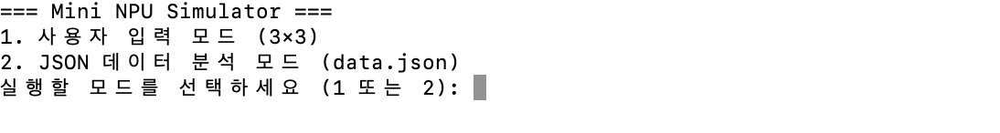
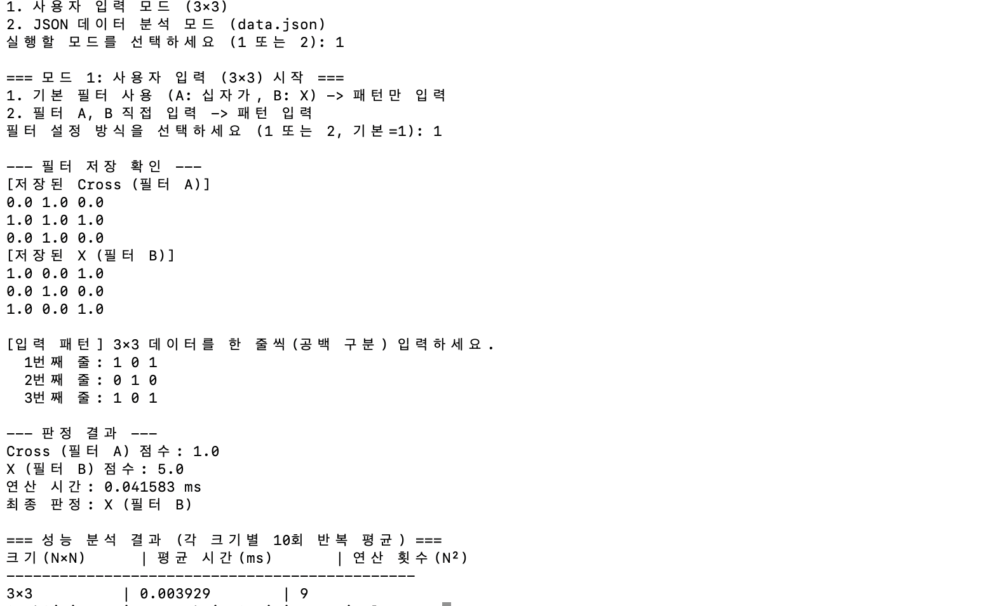
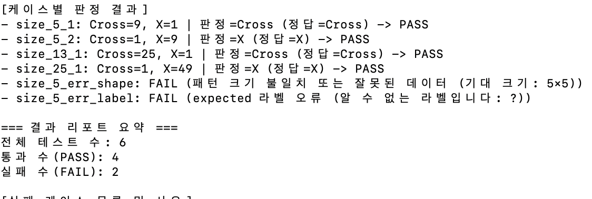
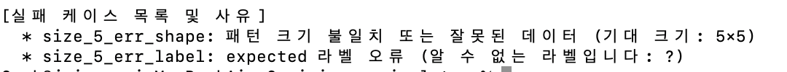

# Mini NPU Simulator

외부 라이브러리(NumPy 등) 없이 순수 Python 기본 기능(`json`, `time`)만으로 AI 패턴 인식의 핵심인 **MAC(Multiply-Accumulate)** 연산을 구현하고, 데이터 검증과 실행 속도를 분석하는 콘솔 프로그램입니다.

---

## 1. 개발 환경 및 프로젝트 구조

| 항목 | 사양 |
| :--- | :--- |
| **언어** | Python 3.x |
| **사용 라이브러리** | `json`, `time` (Python 기본 내장) |
| **실행 환경** | macOS Terminal |
| **개발 도구** | Visual Studio Code |

```text
mini-npu-simulator/
├── main.py          # MAC 연산, 입력/데이터 검증, 판정 및 성능 측정
├── data.json        # 크기별(5×5, 13×13, 25×25) 필터와 테스트 패턴
├── README.md        # 프로젝트 설명 및 결과 리포트
└── screenshots/     # 실행 화면 캡처 이미지
```

---

## 2. 실행 방법

`main.py`와 `data.json`이 같은 폴더에 있는지 확인한 뒤 터미널에서 실행합니다.

```bash
python3 main.py
```

* **모드 1 (사용자 입력, 3×3)**: 기본 필터(Cross/X)를 바로 쓰거나 필터 A·B를 직접 입력합니다. 필터 저장을 확인한 뒤 3×3 패턴을 입력하면 점수, 연산 시간(ms), 판정 결과, 3×3 성능 표가 출력됩니다. (숫자 개수나 형식이 틀리면 해당 줄을 다시 입력받습니다.)
* **모드 2 (JSON 분석, `data.json`)**: 파일에서 필터와 패턴을 불러와 크기와 형식을 검사한 뒤, 케이스별 판정(`Cross`/`X`/`UNDECIDED`)과 `PASS`/`FAIL`, 크기별 성능 표(3×3, 5×5, 13×13, 25×25), 최종 요약 리포트를 출력합니다.

---

## 3. 핵심 원리 및 설계 구조

### 3.1 MAC(Multiply-Accumulate) 연산 원리
입력 패턴과 기준 필터를 겹쳐 놓고, **같은 칸에 있는 숫자끼리 곱한 뒤 그 결과를 전부 더하는 계산**입니다.

$$\text{MAC} = \sum_{i=0}^{N-1} \sum_{j=0}^{N-1} (I_{i,j} \times F_{i,j})$$

* 모양이 비슷할수록 겹치는 `1`이 많아져 점수가 높아집니다.
* 외부 라이브러리 없이 이중 `for`문(`mac_operation`)으로 바둑판 모양의 2차원 리스트(`matrix[row][col]`)를 한 칸씩 돌며 계산합니다.

### 3.2 라벨 정규화(`normalize_label`)를 함수로 나눈 이유
데이터마다 같은 뜻인데 다르게 적힌 이름표(`+`, `cross` → `Cross` / `x` → `X`)를 하나의 표준 이름으로 통일하는 번역기 함수입니다.
* **재사용**: 필터 이름을 읽을 때와 정답(`expected`)을 확인할 때 똑같은 함수를 불러다 쓸 수 있어 코드가 깔끔해집니다.
* **쉬운 수정**: 나중에 새로운 모양(예: `O`)이 추가되어도 판정 코드를 건드리지 않고 `LABEL_MAP` 사전에 한 줄만 추가하면 됩니다.

### 3.3 소수점 오차와 동점 기준 (`epsilon = 1e-9`)
컴퓨터는 소수를 2진법으로 계산하기 때문에, 수학적으로 똑같은 숫자라도 계산 끝에 아주 미세한 오차가 남을 수 있습니다.
* 그래서 두 점수가 완전히 같은지(`==`) 비교하지 않고, 두 점수의 차이가 `1e-9`(0.000000001)보다 작으면 사실상 같은 점수로 보고 `UNDECIDED`(판정 불가)로 처리합니다.

### 3.4 순수 연산 시간 측정 (`time.perf_counter`)
파일을 읽거나 화면에 글자를 출력하는 시간은 빼고, **오직 `mac_operation()`이 계산하는 시간만** 초정밀 스톱워치(`time.perf_counter`)로 잽니다. 한 번만 재면 오차가 크므로 크기별로 10번 반복해 평균 시간(ms)을 구합니다.

---

## 4. `data.json` 테스트 결과 및 실패 원인 분석

모드 2 실행 결과, 전체 6개 테스트 케이스 중 **통과(PASS) 4건, 실패(FAIL) 2건**으로 집계되었습니다.

| 케이스 ID | 기대 크기 | 판정 결과 | 결과 | 원인 분류 |
| :--- | :---: | :---: | :---: | :--- |
| `size_5_1` | 5×5 | Cross | PASS | 정상 통과 |
| `size_5_2` | 5×5 | X | PASS | 정상 통과 |
| `size_13_1` | 13×13 | Cross | PASS | 정상 통과 |
| `size_25_1` | 25×25 | X | PASS | 정상 통과 |
| `size_5_err_shape` | 5×5 | - | FAIL | 데이터 크기 불일치 (2×5 입력) |
| `size_5_err_label` | 5×5 | - | FAIL | 라벨 스키마 오류 (`expected: '?'`) |

* **정상 케이스 통과 이유**: 4개 정상 케이스 모두 `normalize_label()`로 이름 표기 차이를 통일했고, `1e-9` 허용오차 기준으로 점수를 비교해 오판정 없이 모두 통과했습니다.
* **실패 케이스 격리 처리**: `size_5_err_shape`는 5×5여야 할 데이터가 2×5로 들어온 오류이며, `is_valid_square_matrix()`가 미리 걸러내어 프로그램이 멈추지 않고 `FAIL`로 처리했습니다. `size_5_err_label`은 사전에 없는 라벨 `'?'`가 들어와 `ValueError`를 잡아 실패 사유를 남겼습니다.
* 결과적으로 모든 실패는 계산 로직 문제가 아니라 입력 데이터 형식 오류 때문임을 확인했습니다.

---

## 5. 성능 분석 및 아키텍처 고찰

### 5.1 크기별 실측 성능 및 시간 복잡도 ($O(N^2)$)

| 크기(N×N) | 평균 시간(ms) | 연산 횟수(N²) | 3×3 대비 연산량 |
| :--- | :---: | :---: | :---: |
| 3×3 | 실측값 입력 | 9 | 1.0배 |
| 5×5 | 실측값 입력 | 25 | 2.8배 |
| 13×13 | 실측값 입력 | 169 | 18.8배 |
| 25×25 | 실측값 입력 | 625 | 69.4배 |

* 가로 $N$칸, 세로 $N$칸을 모두 한 번씩 계산하므로 총 연산 횟수는 정확히 $N \times N = N^2$번입니다. 이를 시간 복잡도 **$O(N^2)$**라고 합니다.
* 한 변의 길이가 3에서 25로 약 8.33배 커지면, 연산 횟수는 9회에서 625회로 약 69.4배($8.33^2$) 늘어납니다. 실제 측정된 평균 시간(ms)도 이에 비례해 제곱으로 증가합니다.

### 5.2 큰 행렬($1000 \times 1000$)일 때의 자원 추정
* **연산량**: 칸 수가 $1000 \times 1000 = 1,000,000$개이므로 필터 1개당 100만 번, 필터 2개(Cross/X)를 비교하면 총 200만 번의 MAC 연산이 필요합니다.
* **메모리 사용량**: 실수 1개를 저장하는 데 8바이트가 필요하다고 보면, 행렬 1개당 약 8MB가 듭니다. 입력 패턴 1개와 필터 2개를 합치면 순수 숫자 데이터만 최소 약 24MB가 필요합니다.
* **예상 실행 시간**: $O(N^2)$ 비율을 그대로 적용하면, $25 \times 25$일 때보다 연산량이 1,600배($1,000,000 / 625$) 많으므로 실행 시간도 약 1,600배 더 걸릴 것으로 추정됩니다.

### 5.3 왜 CPU 대신 NPU가 필요할까?
* **CPU (순서대로 처리하는 만능 일꾼)**: CPU는 다양한 작업을 빠르게 처리하지만, 이 프로그램처럼 반복문으로 수백만 개의 칸을 하나씩 순서대로 계산하면 시간이 오래 걸립니다. 또한 메모리에서 숫자를 계속 꺼내오는 과정에서도 병목(기다림)이 생깁니다.
* **NPU (한꺼번에 계산하는 AI 전용 칩)**: NPU는 수많은 MAC 계산기를 한 번에 동시에 돌리는 **병렬 처리** 구조를 사용합니다. 큰 행렬을 작은 조각으로 나누어 메모리 이동을 줄이고 여러 칸을 동시에 계산하기 때문에, 대규모 AI 연산에서 CPU보다 훨씬 빠르고 효율적입니다.

---

## 6. 실행 화면


### 6.1 모드 1: 사용자 입력 (3×3) 실행 결과


### 6.2 모드 2: `data.json` 일괄 판정 및 결과 요약


### 6.3 실패 원인 


### 6.4 선택 화면 
